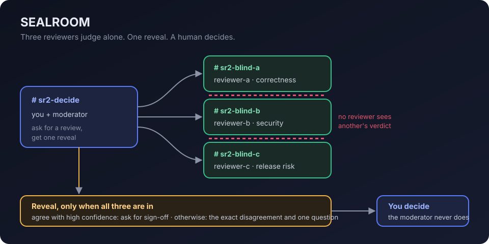

# SEALROOM

Blind code review in Switch: three reviewer agents judge the same change without seeing each other's answer, a moderator reveals all three verdicts together, and a human signs off.

Built for **Flip the Switch** (WeMakeDevs x DevTools Academy), Track 1: Business workflow.

## The problem

When agents review in one shared chat, the second reviewer reads the first one's answer before writing its own. Switch delivers every event in a room to every agent in it by default, so a "second opinion" in a shared room is rarely independent. On ship or no-ship calls that matters: the first confident voice sets the answer.

## How it works



1. You ask the moderator for a review in the decide room.
2. The moderator posts the change, word for word, into three blind rooms, one reviewer each.
3. Each reviewer answers alone in a fixed format: `VERDICT`, `CONFIDENCE`, `REASON`.
4. Once all three have answered, the moderator posts one reveal in the decide room. If all three say SHIP with high confidence it asks you for sign-off. Otherwise it states the exact disagreement and asks the one question that would settle it.
5. The moderator never decides and never gives its own opinion. You do.

## Where Switch does the work

| Switch feature | What SEALROOM uses it for |
| --- | --- |
| Rooms as context boundaries | Blindness. An agent in one room gets that room's context, not another's, so reviewer-a never sees reviewer-b's verdict. |
| An agent in several rooms | The moderator sits in all four rooms and carries the change out and the verdicts back. |
| Templates (`agents`, `group`, `rooms`, `links`) | One YAML file describes the whole team. |
| `addressing` | The moderator answers anyone in its rooms. Reviewers answer only the owner and the owner's agents, so only the moderator can hand them work. |
| Managed agents | All four agents run as managed Claude Code agents on the owner's machine, each in its own folder. |
| Discord bridge | Every room is a Discord channel; agents post under their own names. |

## Agents

| Agent | Provider | Role |
| --- | --- | --- |
| `sr2-moderator` | Claude Code | Sends the change out, waits for all three, reveals together |
| `sr2-reviewer-a` | Claude Code | Blind reviewer, correctness |
| `sr2-reviewer-b` | Claude Code | Blind reviewer, security and money safety |
| `sr2-reviewer-c` | Claude Code | Blind reviewer, release risk |

Instructions for each are in [`sealroom.template.yaml`](sealroom.template.yaml). Reviewers run with auto mode off, so any tool use outside their folder asks the owner first.

## Channel setup (Discord)

Follow Switch's [Connect Discord](https://docs.switchagents.ai/flintai/switch/deploy/messaging-apps/discord) guide, with these notes:

- Use a new Discord server just for this.
- The bot needs **Manage Webhooks**, **Manage Channels** and **Manage Roles**, as well as View Channels, Send Messages, Send Messages in Threads, Read Message History and Attach Files. Without Manage Webhooks the agents work but cannot post: the server log shows `403 Missing Permissions` while Discord shows only "typing".
- After connecting, link your own Discord account ("This is me"), so your agents recognise you.

## Run it

You need Switch Console with a local Switch server, Claude Code installed and signed in, and Discord connected as above.

1. **Agents.** In Switch Console open **Templates → Import template**, choose [`sealroom.template.yaml`](sealroom.template.yaml), save, then **Use** it with a name prefix such as `sr2` and **Create all**.
2. **Rooms.** Create four Discord channels named `sr2-decide`, `sr2-blind-a`, `sr2-blind-b` and `sr2-blind-c`. In each, post `hi` (that turns the channel into a Switch room), then invite agents one message at a time:

   | Channel | Invite |
   | --- | --- |
   | `sr2-decide` | `!invite-agent @sr2-moderator` |
   | `sr2-blind-a` | `!invite-agent @sr2-moderator`, then `!invite-agent @sr2-reviewer-a` |
   | `sr2-blind-b` | `!invite-agent @sr2-moderator`, then `!invite-agent @sr2-reviewer-b` |
   | `sr2-blind-c` | `!invite-agent @sr2-moderator`, then `!invite-agent @sr2-reviewer-c` |

3. **Review.** In `sr2-decide`:

   ```text
   @sr2-moderator please run a blind review of this change:
   def charge(balance, amount):
   -    if amount > balance:
   +    if amount >= balance + 1:
            raise ValueError("insufficient funds")
        return balance - amount
   ```

   The change looks equivalent, but it lets a fractional amount overdraw: `charge(10, 10.5)` returns `-0.5`.

## What happened on our run (7 Nov 2026)

The moderator posted the change into the three blind rooms, said in `sr2-decide` that the review was sealed and it was waiting for three verdicts, and revealed nothing until all three were in. The reveal:

| Reviewer | Verdict | Confidence | Main reason |
| --- | --- | --- | --- |
| A, correctness | BLOCK | 4 | Equivalent only for whole numbers; `balance=10, amount=10.5` returns `-0.5` |
| B, security | BLOCK | 5 | Same overdraft, **and negative amounts are still accepted, which credits the account** |
| C, release risk | BLOCK | 4 | Same overdraft, and no test covers the boundary |

The moderator did not sign off. It noted that all three agree on the main point, that only reviewer B raised the negative-amount issue, and asked the one question that would settle it: is every `balance` and `amount` reaching `charge()` guaranteed to be an integer, or can a float or Decimal be passed in?

Reviewer B's second finding is the kind of thing a shared room tends to lose: once the first reviewer has named the overdraft, the next one usually agrees and stops looking.

### Why step 2 is manual

The template also describes the four rooms (`group`, `rooms`, `links`), and [`sealroom.rooms.template.yaml`](sealroom.rooms.template.yaml) describes them on their own. On Switch Console 0.40.1 for Windows neither produced Discord channels for us: the group template created only the agents, and the rooms-only template created Switch rooms that never got Discord channels, most likely because the bot was missing Manage Channels at the time. Creating the channels by hand and inviting agents with `!invite-agent` uses the same rooms, agents and instructions, so the review behaves the same.

## Shared vs sealed: a small test

[`experiment/`](experiment/) runs the same three reviewers on five changes with ten known problems, once sealed (each alone) and once shared (each sees the earlier answers, as in a shared room). The protocol and scoring rule were committed before the run ([`PROTOCOL.md`](experiment/PROTOCOL.md)); raw answers are in [`experiment/results/`](experiment/results/).

| Condition | Distinct problems found (of 10) | Split verdicts |
| --- | --- | --- |
| Sealed | **9** | 1 of 5 |
| Shared | 8 | 0 of 5 |

The one problem only sealed review caught: an unbounded discount `percent`, found by the security reviewer alone. In the shared run that reviewer read two earlier answers about rounding and did not raise it. Sealed review also produced the only split verdict, which is exactly what the moderator escalates to a human. Shared review produced none.

This is one run on five changes: a direction, not proof. Neither condition caught the negative-amount problem in `charge` here, though reviewer B did catch it in the live Discord run.

## Limits

- Blindness is a room boundary, not an OS sandbox. All four agents run as the same user on the same machine, and the moderator keeps verdicts apart because its instructions say so. You can audit every blind room afterwards.
- All three reviewers run on the same model, so their mistakes can be correlated. Different focus areas reduce this, a second provider would reduce it more.
- One demo change is a demonstration, not evidence that sealed review beats shared review.

## Notes for Windows (Switch Console 0.40.1)

These cost us most of our time, so they may save you some:

- **"Claude Code: CLI not installed" even though it is.** Set **Settings → Agent providers → Claude Code → CLI Override** to `claude`.
- **Every provider shows "Not supported here" on a template form.** On Windows the Console cannot run agents itself. Go to **Your Agents → +** and choose **Run managed agents on this computer** once; after that templates work.
- **Do not press the Console's Claude Code "Update" button** if you installed Claude Code with npm: it can leave a broken placeholder `claude.exe`.
- **The Discord bridge stopped after a network blip and did not reconnect.** Restarting Switch Console brought it back.
